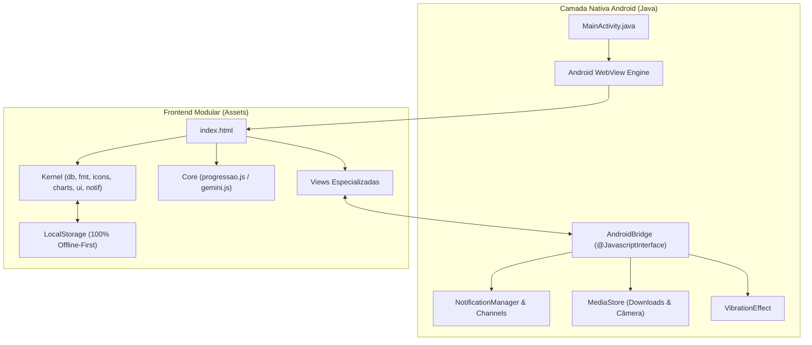

# 📱 Workspace de Aplicativos Android: Evolução & NutriTrack

Este repositório reúne dois aplicativos Android integrados e complementares voltados para alta performance física e saúde: **Evolução** (rastreamento de treino com autorregulação) e **NutriTrack** (rastreamento de nutrição com análise visual por Inteligência Artificial).

Ambos os projetos compartilham uma arquitetura moderna, leve e desacoplada: **frontend modular de alto desempenho (Vanilla JS/CSS)** encapsulado em uma camada nativa **Android WebView** com ponte bidirecional (**JavaScript Interface Bridge**) e pipeline de build totalmente automatizado por linha de comando.

---

## 📂 Visão Geral dos Projetos

| Projeto | Nome do App | Pacote Android | Foco Principal | Principais Recursos |
| :--- | :--- | :--- | :--- | :--- |
| [`evolucao-android`](file:///c:/Users/gabri/OneDrive/Área%20de%20Trabalho/Android/evolucao-android) | **Evolução** | `com.evolucao.treino` | Treino e Musculação | • Motor de autorregulação por RIR (Repetições na Reserva)<br>• Estimativa contínua de 1RM e deload automático<br>• Timer com notificação contínua e vibração nativa<br>• Teclado numérico in-app e visualizador anatômico |
| [`nutricao-android`](file:///c:/Users/gabri/OneDrive/Área%20de%20Trabalho/Android/nutricao-android) | **NutriTrack** | `com.nutricao.app` | Nutrição e Calorias | • Análise visual de fotos de refeições via Google Gemini<br>• Modo Preciso com amostragem tripla e descarte de outliers<br>• Calculadora de TDEE / Mifflin-St Jeor<br>• Banco de alimentos brasileiros e plano semanal |

---

## 🏛️ Arquitetura Técnica Unificada



### 1. Camada Nativa e Bridge (`MainActivity.java`)
- **WebSettings otimizadas:** JavaScript ativado, suporte a `DomStorage`, `allowFileAccess` e `allowUniversalAccessFromFileURLs` para carregamento assíncrono seguro a partir de `file:///android_asset/`.
- **Interação com o Sistema:**
  - `saveBackup(json, filename)`: grava backups diretamente em `Downloads/` via MediaStore (Android 10+ / API 29+) ou no armazenamento isolado do app.
  - `startRestNotification(...)` e `stopRestNotification()`: controle de cronômetro com ticker em segundo plano.
  - `vibrate(ms)`: resposta tátil nas ações e fim de descanso.
  - `onShowFileChooser`: integração com a câmera e galeria com suporte a `EXTRA_OUTPUT` via MediaStore URI.

### 2. Camada Frontend (Modular)
- **Zero frameworks pesados:** Código escrito em JavaScript moderno puro, com divisão em camadas:
  - `core/`: Algoritmos puros (motor de progressão matemática, integração com a API Gemini).
  - `kernel/`: Utilitários reutilizáveis (formatação de datas/pesos, gráficos vetoriais SVG, controle de banco local, diálogos e toasts).
  - `views/`: Telas e controladores reativos.
- **Merge Inteligente de Dados:** Algoritmo que combina backups sem sobrescrever registros já existentes.

### 3. Pipeline de Build Autônomo (`build.ps1`)
Ambos os projetos dispensam a instalação do Android Studio ou do Gradle no computador:
1. **Toolchain Portátil:** O script baixa o JDK 17 (Temurin) e o Android SDK (`cmdline-tools`, `platforms;android-34`, `build-tools;34.0.0`) na pasta `_toolchain/`. O `nutricao-android` reutiliza automaticamente a toolchain do `evolucao-android` quando posicionados lado a lado.
2. **Patch Binário de Assets (Fix Windows AAPT2):** Corrige o comportamento do `aapt2.exe` no Windows que grava caminhos com contra-barra (`\`), substituindo-os in-place no ZIP por barras normais (`/`).
3. **Cadeia de Compilação:** `aapt2` (recursos e manifest) $\rightarrow$ `javac` $\rightarrow$ `d8` (conversão para DEX) $\rightarrow$ injeção no APK $\rightarrow$ `zipalign` $\rightarrow$ `apksigner` com `debug.keystore` persistente.

---

## 🛠️ Como Compilar os Projetos

### 1. Evolução Treino
```powershell
cd evolucao-android
powershell -ExecutionPolicy Bypass -File build.ps1
```
*Gera: `evolucao-android/Evolucao.apk`*

### 2. NutriTrack
```powershell
cd nutricao-android
powershell -ExecutionPolicy Bypass -File build.ps1
```
*Gera: `nutricao-android/NutriTrack.apk`*

---

## 🧪 Testes Automatizados

Para executar os testes unitários do motor de progressão:
```bash
node evolucao-android/app/src/test/js/progressao.test.js
```

---

## 📋 Recomendações para o Git

Ao versionar este repositório, certifique-se de ignorar artefatos temporários, caches de build e a toolchain de compilação:

```gitignore
# Toolchains e SDKs locais
_toolchain/
**/_toolchain/

# Artefatos de compilação
build/
**/build/
*.apk
*.idsig
*.zip

# Pastas temporárias
_temp_kernel/
_temp_views/
**/_backup_monolito/

# Arquivos de sistema e editores
.DS_Store
Thumbs.db
.idea/
.vscode/
```
