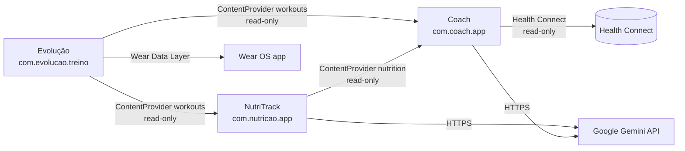
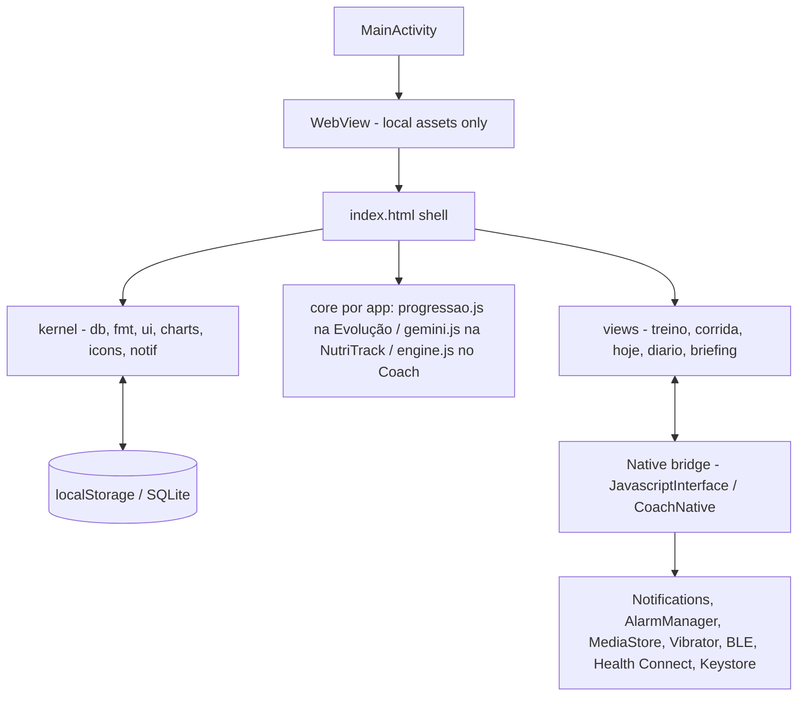

# Architecture and repository map

## System overview

Three independent APKs, no backend, no shared server. Integration is on-device only:

Each app follows the same hybrid pattern: a thin native shell hosts a local WebView UI, with a narrow JS bridge for system capabilities.

## Repository map

| Path | What lives there |
| --- | --- |
| `evolucao-android/` | Evolução app. Gradle multi-module (`app`, `protocol`, `wear`). Portable build via `build.ps1` → `build-wear.ps1`. |
| `evolucao-android/app/src/main/java/com/evolucao/treino/` | `MainActivity.java` (WebView + `AndroidBridge`), `WorkoutProvider.java`, `RestAlarmReceiver.java`, BLE scale files, `wear/` listener + repository. |
| `evolucao-android/app/src/main/assets/` | `index.html` shell, `kernel/` (app, db, fmt, icons, charts, ui, notif, theme), `core/progressao.js`, `apps/evolucao/` (dados, logic, strava, peso, maratonaplano, wear-sync, views). Script order is load order — see `index.html`. |
| `evolucao-android/protocol/` | Pure Kotlin Wear sync protocol: `Models.kt`, `ProtocolJson.kt`, `ProtocolValidator.kt`, `EventReconciler.kt`, `WearTransport.kt` + unit tests. |
| `evolucao-android/wear/` | Wear OS companion app + `ARCHITECTURE_WEAR.md`, `SYNC_PROTOCOL.md`. Phone↔watch via Data Layer (`/evolucao/v1/envelopes/`, `/evolucao/v1/poke`). |
| `evolucao-android/app/src/test/js/` | 41 Node test files, runner `run_all.js`. `app/src/test/java/` has Room/Robolectric tests (run via Gradle). |
| `nutricao-android/` | NutriTrack app. No Gradle — manual `build.ps1` (`aapt2` → `javac` → `d8` → `zipalign` → `apksigner`). |
| `nutricao-android/app/src/main/java/com/nutricao/app/` | `MainActivity.java` (WebView + `AndroidBridge`, camera/audio/alarms), `NutritionProvider.java`, `NotificationReceiver.java`. |
| `nutricao-android/app/src/main/assets/` | `apps/nutricao/index.html` shell, `apps/nutricao/` (`estado.js`, `referencia.js`, `logic.js`, `nav.js`, `views/hoje\|diario\|alimentos\|metas\|ajustes.js`), `core/gemini.js` (all Gemini flows). `kernel/{fmt,notif,ui}.js` exist only as test harness for 3 suites — the app itself uses `estado.js`/`logic.js`/`nav.js` (`escapeHtml`, `toast`, `openModal`). |
| `nutricao-android/app/src/test/js/` | 31 Node test files, runner `run_all.js`. |
| `coach-android/` | Coach app. Single-module Gradle (`app`). Kotlin + local `assets/www/` UI. |
| `coach-android/app/src/main/java/com/coach/app/` | `MainActivity.kt` (bridge host), `domain/` (contracts, snapshot, logical day), `data/` (`CoachDatabase.kt`, `Schema.kt`, `SnapshotStore.kt`), `health/`, `bridge/`, `ai/` (gateway, validator, request builder), `security/` (Keystore), `notify/` (05:40 briefing). |
| `coach-android/app/src/main/assets/www/` | `index.html`, `js/engine.js` (deterministic engine), `js/main.js`, `css/app.css`. |
| `coach-android/app/src/test/` | `js/engine.test.js`, `js/system-insets.test.js`, `js/ui-smoke.js` + JUnit/Robolectric under `test/java`. |
| `tools/marathon-plan/` | Proveniência do plano Maratona BH 2027: xlsx + JSON + `gen_maratona.js` (regenere `maratonaplano.js` a partir daqui; nunca editar o gerado à mão). |
| `docs/coach/` | Design prompts carried over from Coach development (`COACH_DESIGN.md`, `OX_ALPHA_*`). Background reading, not contracts. |
| `test.ps1` | Root runner: Evolução suite → NutriTrack suite → Coach `engine` + `insets` suites. |

> **Nunca commitar:** `_toolchain/` (JDK+SDK portáteis, ~1 GB, compartilhado via `evolucao-android/`), `build/`, `.gradle/`, `*.apk`, `local.properties`, `coach-android/artifacts/` (screenshots do `ui-smoke.js`), `backup/` (histórico de agentes). Ver `.gitignore`. `adb`/`fastboot` vêm do SDK do sistema ou de `_toolchain/android-sdk` — não vendorizar binários no repo.

## Entry points

- **Evolução:** `evolucao-android/app/src/main/assets/index.html` → `kernel/app.js`; native `MainActivity.onCreate` sets up WebView, notification channels (`descanso`, `descanso_alerta`), `AndroidBridge`, file chooser, BLE/Wear wiring.
- **NutriTrack:** `nutricao-android/app/src/main/assets/apps/nutricao/index.html` → `render()` in views; native `MainActivity.onCreate` sets up WebView, `AndroidBridge`, camera `EXTRA_OUTPUT`, audio recorder, alarm sync.
- **Coach:** `coach-android/app/src/main/assets/www/index.html` → `js/main.js`; native `MainActivity` serves only `https://appassets.androidplatform.net/assets/www/` via `WebViewAssetLoader`, exposes `CoachNative` methods gated by `BridgeProtocol`.

## How a request moves

**Evolução set logged (offline):** `views/treino.js` keypad → `state.draft` in `kernel/db.js` → `save()` to `localStorage['evolucao_treino_state']` → `syncNative()` mirrors `{sessions, corridas, peso}` to `SharedPreferences['evolucao_workouts_export']` for the provider → optional rest timer via `AndroidBridge.startRestNotification`.

**NutriTrack photo (online):** `views/hoje.js` file input → `core/gemini.js: processarFoto` (decode + timeout) → `consultarModelo` (1× fast or 3× precise + outlier trim) → Structured-Output JSON validated locally → saved under `nt_meals[date]` → `syncNutritionSummary` mirrors aggregates to `nutritrack_coach_export`.

**Coach briefing (offline-first):** `MainActivity` → `HealthSyncCoordinator` + `LocalAppSync` read Health Connect and the two providers → `SnapshotStore` upserts `source_record` rows → `DailySnapshotBuilder` builds canonical JSON → SHA-256 `snapshot_hash` → `engine.js: analyze()` (pure) → `plan_run` + `proposal` rows → optional `GeminiGateway.review` (preview receipt → native dialog → HTTPS → `GeminiValidator`) → cached `gemini_opinion`. UI decisions write only to `decision` rows (`applied_to_source` stays null in 0.2.0).

## External integrations

| Integration | Direction | Where |
| --- | --- | --- |
| Google Gemini (`generativelanguage.googleapis.com`) | NutriTrack JS and Coach Kotlin, outbound HTTPS only | `nutricao-android/.../core/gemini.js`, `coach-android/.../ai/GeminiGateway.kt` |
| Strava (`strava.com/api/v3`) | Evolução JS import, token handled in-app | `evolucao-android/.../apps/evolucao/strava.js`; safe-backend design in `coach-android/STRAVA_INTEGRATION.md` (not implemented — Coach reads runs only via Evolução) |
| Health Connect (`connect-client 1.1.0`) | Coach read-only: sleep, steps, resting HR, weight | `coach-android/.../health/` |
| Wear OS Data Layer | Evolução phone ↔ watch envelopes | `evolucao-android/protocol/`, `.../wear/MobileWear*`, `assets/apps/evolucao/wear-sync.js` |
| BLE scale (Davely) | Evolução reads weight over BLE | `ScaleBleScanner.java`, `DavelyScaleParser.java`, `views/ble-diag.js` |

## Background work and scheduling

- **Evolução rest timer:** exact alarm via `AlarmManager` + `RestAlarmReceiver` (needs `SCHEDULE_EXACT_ALARM`/`USE_EXACT_ALARM`); in-process `Handler` fallback; ongoing chronometer notification + Wear mirror.
- **NutriTrack reminders:** `AlarmManager` alarms from `nt_reminders` via `syncAlarms`/`scheduleAlarm`; `NotificationReceiver` re-registers on `BOOT_COMPLETED`/`MY_PACKAGE_REPLACED`.
- **Coach briefing:** inexact `setAndAllowWhileIdle(RTC_WAKEUP)` around 05:40 via `BriefingScheduler`; `BootReceiver` reschedules after reboot/time changes. Deliberately no exact-alarm permission.

See [flows](flows.md) for bridge/provider method tables and [database](database.md) for the data model.
