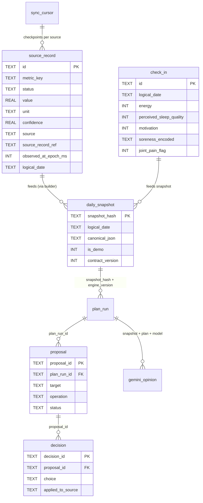

# Database and data model

There is no server database. Each app persists locally, and cross-app reads go through versioned `ContentProvider` mirrors — never through another app's private files.

> Repository schema vs. live state: everything below comes from code in the repo. Contents of any emulator/phone database were not inspected.

## Technology choices

| App | Store | Schema location | Key file |
| --- | --- | --- | --- |
| Evolução | `localStorage` JSON + `SharedPreferences` export mirror | `kernel/db.js` (`DEFAULT_STATE`, `migrate()`, `mergeState()`) | `evolucao-android/app/src/main/assets/kernel/db.js` |
| NutriTrack | `localStorage` JSON + `SharedPreferences` export mirror | `estado.js` (`LS` keys), `logic.js` aggregations | `nutricao-android/app/src/main/assets/apps/nutricao/estado.js` |
| Coach | Private SQLite via `SQLiteOpenHelper` (`coach.db`), v1 | `Schema.kt` (DDL + `MIGRATIONS`), `CoachDatabase.kt`, `SnapshotStore.kt` | `coach-android/app/src/main/java/com/coach/app/data/Schema.kt` |

Room is used only for the Evolução Wear inbox/outbox on the phone (`app/src/test/java`, `app/schemas/`); the workout/nutrition data itself is JSON in `localStorage`.

## Evolução data model (`localStorage['evolucao_treino_state']`)

Top-level keys in `DEFAULT_STATE` (`kernel/db.js`):

- `ficha.{A,B,C}` — routine: `{nome, ex[]}` where each exercise is `{n, id, aliases[], rest, sets, reps, eq, inc, perSide}`. `id` is canonical (`ex_…`, alias-aware from `exercicios/nomes.js`); persisted IDs survive renames.
- `sessions[]` — strength sessions: `{id, date (logical YYYY-MM-DD), day (A/B/C), mode, entries:{exerciseKey: [{w, r, rir, wu, done}]}, duration, notes}`. `w` = carga kg, `r` = reps, `rir` clamped 0–6, `wu` = warm-up flag.
- `corridas[]` — runs: `{id/stravaId, date, distanciaKm, duracaoSeg, ritmoMedioSegKm/paceMinKm, velocidadeMediaKmh, calorias, mode, intervalos[]}`.
- `peso[]` — weigh-ins: `{date, kg}` (20–400 kg enforced at the provider boundary).
- `draft` — in-progress workout: `{day, date, dateExplicit, entries, warmupMode, startedAt, lastActiveAt, sessionMode}`. Stale drafts (>3 h inactive) are discarded (`checkDraftInactivity`).
- `draftCorrida`, `marathonState{assoc,pain,notes,checkpoints}`, `wearSync{…}`, `settings{restAuto, alarm, autoAdvance, progressao{enabled, stallSessions:3, deloadPct:10, targetRir:2, …}}`, `cardioGoalKm: 15`.

Lifecycle rules visible in code: `migrate()` is additive/idempotent (fills missing keys, upgrades legacy `warmup→wu`, replaces the legacy default routine); `save()` warns once per session on quota failure and always calls `syncNative()`; `mergeState()` unions by content signature (`sessionSig`, `corridaSig`, peso by date) — restores never delete current records.

## NutriTrack data model (`localStorage` keys in `estado.js`)

| Key | Content |
| --- | --- |
| `nt_meals` | `{[date]: {meals: [{id, nome, itens: [{nome, porcao_g, kcal, proteina_g, carbo_g, gordura_g}], kcal_total, …}], waterMl?, …}}` |
| `nt_water` | Water log per date (ml). |
| `nt_profile` | `{pesoKg, alturaCm, idade, sexo, nivelAtividade}` — feeds TDEE/Mifflin-St Jeor. |
| `nt_todos` / `nt_pref` / `nt_habits` / `nt_reminders` / `nt_activities` | Targets, preferences, habits, alarm defs (`{id, title, message, hour, enabled}`), activity/MET log. |
| `nt_apikey` | Raw Gemini key (plain `localStorage` — user-managed, see [configuration](configuration.md)). |
| `nutritrack_coach_export` (`SharedPreferences`, key `summaries`) | Aggregate mirror `{days: [{date, mealCount, energyKcal, proteinG, carbsG, fatG, waterMl, hasWaterLog, targets{…}}]}` written by `syncNutritionSummary`. Names/items/photos/habits/keys never enter this mirror. |

Date keys are logical `YYYY-MM-DD` (`localDateStr`), validated by `isValidDateKey`; future dates are rejected in `setActiveDate`.

## Coach SQLite (schema v1, 8 tables)

From `data/Schema.kt` (`MIGRATIONS[0]`). `MetricValue` states are `OBSERVED`/`INFORMED`/`ESTIMATED`/`ABSENT`; absent slots are derived, never stored in `source_record`.



- `source_record.id` is stable: `local:evolucao|nutritrack:DATE:metric_key` (see `LocalAppSync.stableId`); upserts are idempotent, checkpointed in `sync_cursor`.
- `daily_snapshot` rows are immutable, keyed by SHA-256 of canonical JSON (`SnapshotHashing`); identical content is never stored twice.
- `plan_run` is unique on `(snapshot_hash, engine_version)`; `gemini_opinion` on `(snapshot_hash, plan_run_id, model, contract_version)`.
- `decision.applied_to_source` stays NULL in 0.2.0 (review-only).
- `clearAllPersonalData()` deletes in dependency order (decisions → opinions → proposals → runs → snapshots → check-ins → records → cursors), plus credential and alarm.

Metric keys (`domain/MetricKeys` + `LocalAppSync`): `body.weightKg`, `running.sessionCount/distanceKm/durationMinutes`, `nutrition.mealCount/energyKcal/proteinG/carbsG/fatG/waterMl/target.*`, `recovery.sleepMinutes/restingHeartRate`, `activity.steps`.

## Cross-app providers (read-only)

| Provider | Authority / path | Example URI | Caller check | What it returns |
| --- | --- | --- | --- | --- |
| `WorkoutProvider` | `com.evolucao.treino.workouts` / `workouts?date=YYYY-MM-DD` | `content://com.evolucao.treino.workouts/workouts?date=2026-09-05` | UID packages must include `com.nutricao.app` or `com.coach.app` | `{schemaVersion:1, source, date, generatedAt, weight:{date,kg}\|null, sessions:[≤20 strength+run, ≤50 exercises, ≤100 sets, notes ≤2000 chars]}` |
| `NutritionProvider` | `com.nutricao.app.nutrition` / `daily?date=YYYY-MM-DD` | `content://com.nutricao.app.nutrition/daily?date=2026-09-05` | UID packages must include `com.coach.app` | `{schemaVersion:1, source, date, generatedAt, summary:{date, mealCount, energyKcal, proteinG, carbsG, fatG, waterMl, hasWaterLog, targets}\|null}` |

Both return a single-row `MatrixCursor(_id, payload)`, validate ISO dates, cap payloads, strip control chars, and throw `UnsupportedOperationException("read-only")` on insert/update/delete. An empty-but-valid payload deletes that day's local mirror; a missing/invalid provider preserves the last valid record and surfaces `UNAVAILABLE`/`ERROR` instead of zero.

Coach adds a D-1 fallback: if today's nutrition payload has no meals/water, `LocalAppSync` queries yesterday and stores it under today's logical date (engine labels it `NutriTrack ontem (D-1)`).

## Local DB operations

```powershell
# No migrations to run by hand. Evolução/NutriTrack migrate on load (migrate()).
# Coach migrates in onCreate/onUpgrade via Schema.migrationStepsFrom().

# Inspect (debug builds only, rooted/emulator):
# adb shell "run-as com.coach.app ls databases/"  # coach.db lives here; allowBackup=false so no auto-backup
```

| Task | How | Destructive? |
| --- | --- | --- |
| Backup Evolução/NutriTrack | In-app **Ficha/Ajustes → backup** → `Downloads/*.json` via `saveBackup` | No |
| Restore | In-app import → `mergeState` union (additive) | No — never overwrites current records |
| Reset Evolução (clears everything) | Clear app data in Android settings, or `localStorage.clear()` in a debug WebView | **Yes — wipes all sessions** |
| Reset NutriTrack | Same as above for `nt_*` keys | **Yes** |
| Reset Coach | In-app **Excluir todos os dados locais** (native confirm) → DB + Keystore + alarm cleared, autosync paused | **Yes — irreversible** |
| Re-seed defaults | Reopen the app; `DEFAULT_STATE` / empty states are recreated automatically | No |

Wear Room schemas live under `evolucao-android/app/schemas/` and `wear/schemas/` — phone inbox/outbox only, not the workout source of truth.
